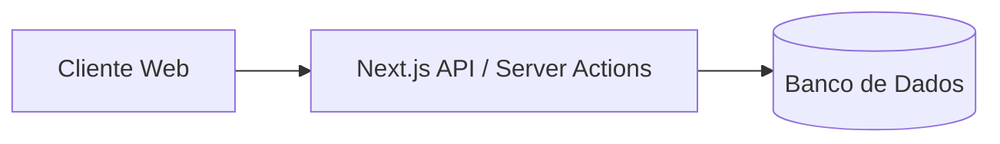

# Nome do Projeto

> Resumo de 1 frase explicando qual problema real este sistema resolve e para quem.

🔗 **Demo ao vivo:** [link-do-deploy.vercel.app](https://) _(Use o botão "Entrar como Visitante" para testar sem cadastro)_  
🎥 **Vídeo Pitch (90s):** [Link do Loom/YouTube](https://)  
📝 **Artigo Técnico:** [Leia os bastidores no blog.mourao.info](https://blog.mourao.info)

---

## 🎯 O Problema e a Solução

Explique brevemente o gargalo que motivou o projeto e como a aplicação resolve isso na prática.

## 🏗️ Arquitetura e Decisões Técnicas

- **Stack:** Next.js, TypeScript, Tailwind CSS, Prisma/PostgreSQL (adapte conforme o projeto)
- **Por que esta arquitetura?** Resumo das principais escolhas técnicas. Detalhes completos em [`/docs`](./docs).

